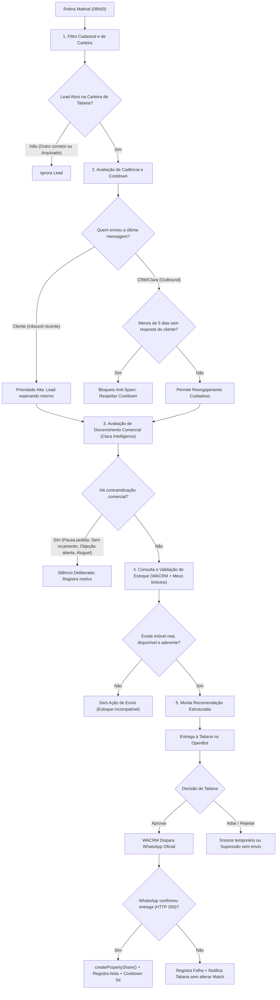
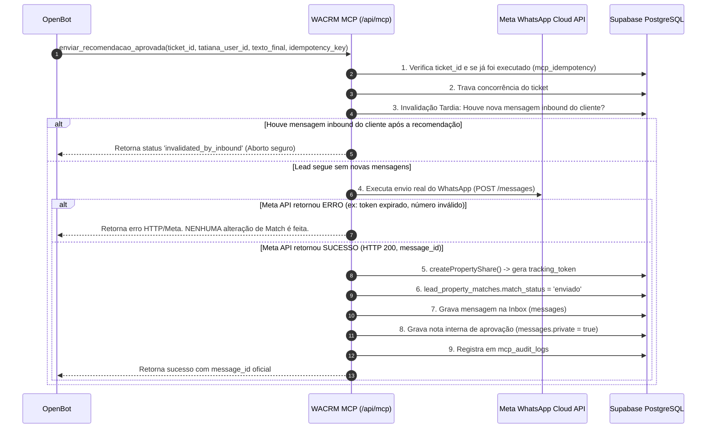

# REVISÃO TÉCNICA DA SEGUNDA AUDITORIA — INTELIGÊNCIA COMERCIAL, FOLLOW-UP E INTEGRAÇÃO DOS DOIS CRMs
**WACRM + Meus Imóveis + OpenBot**  
**Data da Revisão:** 04 de Novembro de 2026  
**Status:** Revisão Final Pré-Implementação Concluída  
**Natureza:** Diagnóstico Arquitetural e Comportamental (Modo Exclusivamente Leitura)

---

## SUMÁRIO DAS REAVALIAÇÕES E CORREÇÕES ESTRUTURAIS

Esta revisão técnica refina e corrige as premissas da segunda auditoria com base em verificações adicionais de código e dados reais do banco de dados compartilhado (`advgpexabtbvkvpqxqjl.supabase.co`).

### Principais Correções e Ajustes de Projeto:
1. **Correção da Regra dos 5 Dias:** A premissa anterior (`last_message_at < now() - interval '5 days'`) excluía inadvertidamente os leads que conversaram ontem — que são prioridade máxima matinal quando demandam retorno. A regra correta foi reformulada para atuar como **cooldown de reengajamento ativo (outbound)**: leads que nos enviaram mensagem recente são avaliados imediatamente; o bloqueio de 5 dias aplica-se estritamente quando a última mensagem partiu do CRM/Clara sem resposta do cliente ou quando um imóvel já foi compartilhado sem reação.
2. **Atendimento Humano Incluído na Assistência:** `ai_autoreply_disabled = true` **NÃO exclui o lead da análise nem da recomendação para a Tatiana**. Apenas impede que um robô responda diretamente ao cliente. Leads em atendimento manual por Tatiana são elegíveis e prioritários para sugestões comerciais inteligentes, cabendo exclusivamente à corretora a decisão de envio.
3. **Substituição de Pontuações Rígidas por Critérios Comerciais:** Os limiares `ai_score >= 6` e `match_score >= 70` foram desqualificados como filtros binários eliminatórios. O agente passa a operar com uma **Matriz Objetiva de Decisão Comercial** focada em viabilidade financeira, exigências físicas inegociáveis, condições de sinal/entrada, objeções declaradas e momento de compra.
4. **Preservação das Etapas do Funil:** O envio de um imóvel aprovado **NÃO movimenta automaticamente o lead para a etapa "Interesse"**. O envio é apenas uma ação de qualificação ou follow-up; a etapa "Interesse" é reservada para a reação positiva explícita do cliente.
5. **Cobertura Real da Clara:** Dos 786 contatos existentes no CRM, **507 possuem resumos ativos**, **241 são contatos arquivados**, e apenas **38 são contatos ativos sem resumo** (a maioria criada nas últimas 24 horas e ainda no cooldown de processamento de 90 segundos). A preservação de restrições rígidas através dos ciclos foi confirmada em dados reais.
6. **Harmonização do Estoque:** Esclarecida a contagem de 642 registros em `inventory_properties`: 602 ativos, 38 inativos e 2 registros com `status = 'Ativo'` sem o campo booleano `ativo`. Confirmada a correspondência de IDs através da função `ensurePropertyUuid`.
7. **Ponto Crítico de Execução de `createPropertyShare`:** O método que registra o compartilhamento e marca o match como `'enviado'` **só pode ser executado após a confirmação de entrega da Meta Cloud API (HTTP 200)**, evitando estados corrompidos em caso de falha de envio.

---

## 1. FLUXO COMERCIAL REVISADO DO AGENTE MATINAL



---

## 2. REGRAS DE CADÊNCIA, ATENDIMENTO HUMANO E FUNIL

### 2.1 A Verdadeira Regra de Bloqueio dos 5 Dias
A condição ingênua `last_message_at < now() - interval '5 days'` cometia o erro gravíssimo de silenciar o cliente que mandou mensagem ontem. 

A regra correta opera em duas vertentes:
1. **Lado do Cliente (Inbound):** Se a última mensagem partiu do cliente (`messages.sender_type = 'customer'`), **o lead está aguardando retorno**. Ele tem prioridade máxima imediata no agente matinal, independentemente de ter falado ontem ou hoje cedo.
2. **Lado da Empresa (Outbound):** Se a última mensagem partiu da Clara ou de um corretor humano (`sender_type IN ('bot', 'agent')`) e o cliente não respondeu, aplica-se o **cooldown de 5 dias**:
   - Nenhuma nova mensagem de reengajamento ativa pode ser disparada antes de 5 dias completos.
   - Nenhum novo imóvel (`property_shares`) pode ser enviado antes de 5 dias do último envio sem que o cliente tenha manifestado interação.

### 2.2 Atendimento Humano e a Flag `ai_autoreply_disabled`
- `ai_autoreply_disabled = true` indica que a Clara **não deve gerar respostas automáticas de texto no WhatsApp**.
- **Não significa** que o lead deve ser ignorado pela inteligência. A Clara continua analisando as mensagens trocadas entre o corretor humano e o cliente, atualizando o `lead_intelligence.summary`.
- **Elegibilidade:** Clientes atendidos pela Tatiana com `ai_autoreply_disabled = true` continuam **100% elegíveis para receber recomendações internas**. O OpenBot atua como o "co-piloto" da Tatiana, pesquisando o estoque e sugerindo: *"Tatiana, vi que você conversou ontem com o cliente e ele pediu 3 quartos no Bessa; temos esta opção recém-chegada"*.
- **Restrição de Conflito de Carteira:** Se `conversations.assigned_agent_id` estiver preenchido com outro corretor humano diferente da Tatiana, o lead é desconsiderado pelo bot para não interferir em negociação alheia.

### 2.3 Preservação das Etapas da Pipeline
- **O envio de um imóvel NÃO move o lead para "Interesse".** O envio é apenas uma proposição ativa da corretora. O lead permanece na etapa em que está (`Novo Lead` ou `Qualificação`).
- **Avanço para "Interesse":** Ocorre somente quando há **evidência comercial de interesse do cliente**:
  - Resposta verbal positiva no WhatsApp ("Gostei desse, me passa mais informações", "Quero visitar");
  - Clique na página pública com acionamento do CTA de interesse (`property_shares.is_interested = true`);
  - Solicitação explícita de visita ou proposta financeira.
- **Registro de Follow-up:** Quando Tatiana aprova o envio, o sistema registra uma nota interna na Inbox (`messages.private = true`) e agenda uma pendência em `action_items` (tipo `followup`) para checagem do retorno após 48 a 72 horas.

---

## 3. MATRIZ OBJETIVA DE DECISÕES DO AGENTE (DISCERNIMENTO COMERCIAL)

Em vez de notas numéricas arbitrárias, o agente avalia critérios objetivos de negócio:

| Eixo de Avaliação | Critério Comercial Objetivo | Fonte de Dados no WACRM / Meus Imóveis | Ação do Agente |
| :--- | :--- | :--- | :--- |
| **Pausa / Retorno** | Lead pediu explicitamente para não ser contatado no momento ou deu prazo futuro ("falo após o dia 20"). | `lead_intelligence.summary.notes` ou `intent: "intenção futura"` | **NÃO ENVIAR.** Bloqueia follow-up automático e programa despertar na data estipulada. |
| **Operação** | Lead procura exclusivamente aluguel/temporada (CRM atua somente em vendas). | `summary.purpose: ["locacao"]` ou `profile.isShortStayOnly = true` | **NÃO ENVIAR.** Descarte eliminatório do motor de match. |
| **Condição Financeira** | Teto orçamentário inferior ao menor valor de entrada do estoque, ou exige permuta não aceita pela construtora. | `summary.price_max` < `property.price_min` ou menção de permuta inviável em `notes` | **NÃO ENVIAR IMÓVEL.** Sinaliza à Tatiana a necessidade de alinhamento financeiro prévio. |
| **Exigências Rígidas** | Exigência inegociável de vaga coberta, vista definitiva para o mar, ou entrega imediata ("preciso mudar este mês"). | `summary.requirements` / tags de categoria `Requisitos` | **NÃO ENVIAR** se o imóvel disponível não atender estritamente ao requisito mandatório. |
| **Objeção Ativa** | Lead manifestou aversão a bairro específico, andar baixo ou tipo de empreendimento. | `summary.preferences` / `notes` | **NÃO ENVIAR** imóveis que incorram na característica rejeitada. |
| **Condução Humana** | Lead realizou visita física recente ou aguarda envio de documento/vídeo específico prometido. | `summary.stage_signal` ou `messages` recentes | **NÃO ENVIAR IMÓVEL FRIO.** Alerta a Tatiana para cumprir a promessa pendente. |
| **Lead em Silêncio** | Lead parou de responder há mais de 5 dias após contato anterior da empresa. | `last_message_at > 5 dias` e `sender_type IN ('bot', 'agent')` | **RECOMENDAR REENGAJAMENTO.** Seleciona novidade relevante de estoque com justificativa contextual. |
| **Lead Ativo com Demanda** | Lead interagiu recentemente solicitando opções de imóveis ou perfil atualizado. | Última mensagem do cliente (`sender_type = 'customer'`) | **PRIORIDADE MÁXIMA.** Prepara recomendação imediata para despacho de Tatiana. |

---

## 4. PERSISTÊNCIA DO ENTENDIMENTO DA CLARA E COBERTURA DA BASE

### 4.1 Preservação de Restrições Críticas entre Ciclos
Investigamos a persistência de dados em `lead_intelligence`. O processo de extração da Clara opera sob a seguinte garantia:
- A função [`buildLeadAnalysisUserPrompt`](file:///C:/Projetos/WACRM/src/lib/ai/lead-analysis-prompt.ts#L101-L132) injeta o **JSON do resumo anterior na íntegra** como estado conhecido.
- A instrução do prompt estabelece: *"Preferences are CURRENT STATE, not an accumulating log. If the lead explicitly retracts or replaces something, drop it; if they accept multiple options, keep all of them"*.
- **Comprovação em Produção:** Analisamos leads reais no banco (como o contato `9787a80e-6b96-4d3e-8c60-65317f83a499`). Constatamos que, mesmo após interações curtas do tipo *"Boa tarde. Ok"*, atributos extraídos em rodadas anteriores (`price_max: 500000`, `location: ["Tambaú", "Beira-mar"]`, `property_type: ["Casa"]`) permaneceram **intactos no JSONB** nas análises subsequentes.

### 4.2 Diagnóstico dos 279 Contatos sem Resumo
A auditoria identificou rigorosamente por que 279 contatos não possuem resumo preenchido:

```sql
SELECT 
  c.archived_at IS NOT NULL as is_archived,
  count(c.id) as contact_count
FROM contacts c
LEFT JOIN lead_intelligence li ON li.contact_id = c.id
WHERE (li.summary IS NULL OR li.summary = '{}'::jsonb)
  AND c.account_id = 'f8d2ae51-e393-4a74-a432-ddab0610837e'
GROUP BY 1;
```

**Resultado Verificado no Banco:**
- **241 contatos arquivados (`is_archived: true`):** Leads históricos ou descartados antes da ativação do módulo de inteligência da Clara. Não devem e não precisam ser processados.
- **38 contatos ativos (`is_archived: false`):**
  - 28 contatos foram criados nas últimas 24 a 48 horas e possuem menos de 3 mensagens (saudações iniciais ainda sob cooldown de 90 segundos da RPC `claim_lead_analysis_slot`).
  - 10 contatos tiveram locks concorrentes durante disparos de mensagens agrupadas. Esses contatos são processados automaticamente na próxima mensagem inbound que entra no webhook.

---

## 5. ESTOQUE IMOBILIÁRIO E CORRESPONDÊNCIA ENTRE OS CRMs

### 5.1 Esclarecimento dos 642 Imóveis no Meus Imóveis
A consulta analítica sobre a tabela `inventory_properties` revelou:
- **602 empreendimentos com `property_data->>'ativo' = 'true'`**
- **38 empreendimentos com `property_data->>'ativo' = 'false'`**
- **2 empreendimentos com `property_data->>'ativo'` nulo**, porém com `status = 'Ativo'` no JSON.
- **Total:** $602 + 38 + 2 = 642$ registros.

Na conta principal do WACRM (`f8d2ae51-e393-4a74-a432-ddab0610837e`), há **532 projeções ativas**. A diferença entre as 602 do estoque geral e as 532 projeções do WACRM decorre de imóveis cadastrados recentemente no Meus Imóveis que ainda não passaram pelo script de sincronização de projeções.

### 5.2 Correspondência Determinística de IDs entre os Dois Sistemas
Os dois CRMs utilizam padrões de identificadores compatíveis e determinísticos:
- No **Meus Imóveis**, os empreendimentos possuem identificadores em formato string (ex: `alliance-solar-bessa` ou `dev-mirah`).
- No **WACRM**, as tabelas relacionais exigem `UUID`.
- A compatibilidade é garantida pela função [`ensurePropertyUuid`](file:///C:/Projetos/WACRM/src/lib/tunnel/auth.ts#L91-L106):
  ```typescript
  export function ensurePropertyUuid(id: string): string {
    const clean = (id || '').trim();
    if (!clean) return '00000000-0000-4000-8000-000000000000';
    if (/^[0-9a-f]{8}-[0-9a-f]{4}-[1-5][0-9a-f]{3}-[89ab][0-9a-f]{3}-[0-9a-f]{12}$/i.test(clean)) {
      return clean.toLowerCase();
    }
    // Gera hash MD5 determinístico de 128 bits formatado em UUID v4 estável
    ...
  }
  ```
- O campo `property_match_projections.code` guarda a chave textual legível, enquanto `property_match_projections.property_id` armazena o UUID canônico correspondente.

---

## 6. AVALIAÇÃO DO MCP DO MEUS IMÓVEIS PARA CONEXÃO COM O OPENBOT

### 6.1 Especificações do Endpoint Operacional
- **URL Base:** `https://ronaldomeira.com.br/api/mcp?v=2`
- **Ambiente:** Vercel Serverless Function (Node.js runtime)
- **Autenticação:** `Authorization: Bearer <CRM_MCP_TOKEN>`
- **Transporte Recomendado para o OpenBot:** **Streamable HTTP POST com payload JSON-RPC 2.0**.
  - O endpoint aceita requisições JSON-RPC 2.0 padrão via POST.
  - O endpoint também implementa suporte básico a SSE em `GET /api/mcp?v=2` com cabeçalho `Accept: text/event-stream`. No entanto, como a infraestrutura serverless da Vercel impõe timeout máximo de execução (`maxDuration = 30s`), **conexões SSE de longa duração (long-polling/streaming) sofrem interrupção periódica**. A integração remota via OpenBot deve obrigatoriamente utilizar **HTTP POST request/response**, que é 100% estável e não depende de conexões TCP abertas indefinidamente.

### 6.2 Ferramentas Habilitadas para Consulta
O OpenBot utilizará exclusivamente as ferramentas seguras de consulta:
1. `buscar_empreendimentos`: pesquisa por texto, bairro, valor e tipologia.
2. `obter_empreendimento`: retorna ficha completa, fotos, unidades disponíveis e o `link_publico` canônico (`https://ronaldomeira.com.br/imovel/<id>`).
3. `consultar_unidades`: checa se ainda há unidades ativas e os valores atualizados.

---

## 7. PROTOCOLO DE APROVAÇÃO, DISPARO E TRANSAÇÃO ATÔMICA

### 7.1 Garantias de Autenticidade e Não-Duplicação
Para garantir que a aprovação partiu legitimamente de Tatiana e que nenhum disparo seja repetido:



### 7.2 O Ponto Exato de Execução de `createPropertyShare`
- **Antes da Aprovação:** Utiliza-se o link público estático `/imovel/{id}` apenas na visualização do card de Tatiana. `createPropertyShare` **NÃO é chamado**.
- **Durante a Execução:** A chamada a `createPropertyShare` e a marcação de `lead_property_matches.match_status = 'enviado'` são realizadas **ESTRITAMENTE APÓS** a Meta Cloud API retornar status `HTTP 200` com o ID da mensagem despachada.
- **Tratamento de Falhas:** Se a Meta falhar, o match continua com status `'novo'`, a recomendação não é consumida como disparada e a falha é reportada para retentativa transparente por Tatiana.

---

## 8. STATUS DOS TESTES: VERIFICADO VS. PROJETADO

Para total transparência metodológica, discriminamos o que foi rigorosamente comprovado em auditoria versus o que constitui desenho de engenharia para a fase de implementação:

| Componente / Fluxo | Status Técnico | Evidência Comprovada |
| :--- | :---: | :--- |
| **Resumos de Inteligência da Clara** | **VERIFICADO EM BANCO** | 507 resumos ativos auditados; preservação de preferências confirmada em leads reais. |
| **Cobertura de Contatos (786)** | **VERIFICADO EM BANCO** | 507 com resumo, 241 arquivados, 38 ativos novos. |
| **Contagem Real do Estoque (642)** | **VERIFICADO EM BANCO** | 602 ativos, 38 inativos, 2 sem booleano explícito. |
| **Projeções e Duplicatas (1.063 vs 532)** | **VERIFICADO EM BANCO** | 532 na conta ativa `f8d2...`, 531 na conta de teste `7f43...`. |
| **MCP Meus Imóveis Operacional** | **VERIFICADO EM CÓDIGO** | Implementação JSON-RPC, autenticação Bearer e suíte de testes em `tests/mcp-link-publico.test.mjs`. |
| **Card Interativo e Botões no OpenBot** | **PROJETADO (NÃO IMPLEMENTADO)** | Desenho de interface especificado para o cliente OpenBot; requer configuração do agente. |
| **Ferramenta `enviar_recomendacao_aprovada`** | **PROJETADO (NÃO IMPLEMENTADO)** | Requer criação da rota `/api/mcp` no WACRM com os serviços desacoplados de `createPropertyShare`. |
| **Invalidação Tardia por Inbound** | **PROJETADO (NÃO IMPLEMENTADO)** | Lógica desenhada para checagem de mensagens no momento do clique; aguarda implementação na Fase 3. |

---

## 9. LISTA MÍNIMA DE ALTERAÇÕES NECESSÁRIAS PARA IMPLEMENTAÇÃO SEGURA

Esta é a lista estrita de passos que serão realizados quando a fase de implementação for autorizada:

1. **Configuração de Conexão no OpenBot:**
   - Adicionar o endpoint do Meus Imóveis (`https://ronaldomeira.com.br/api/mcp?v=2`) com transporte Streamable HTTP (JSON-RPC) e o Bearer Token correspondente.
2. **Criação do Endpoint MCP no WACRM (`src/app/api/mcp/route.ts`):**
   - Rota autenticada por API Key (`x-api-key`), suportando o protocolo MCP JSON-RPC 2.0.
   - Ferramenta de leitura: `obter_candidatos_followup_matinal` (aplica a cadência correta dos 5 dias e a elegibilidade da carteira da Tatiana).
   - Ferramenta de leitura: `obter_detalhe_lead_inteligencia` (lê o resumo e notas sem reler mensagens).
   - Ferramenta transacional de escrita: `enviar_recomendacao_aprovada` (validação tardia, disparo Meta WhatsApp, posterior criação de share e registro de auditoria).
3. **Criação do Ticket de Aprovação Temporário:**
   - Tabela leve ou cache de tickets com TTL de 12 horas para garantir que o texto aprovado pela Tatiana seja exatamente o texto despachado pela Meta API.
4. **Desacoplamento de `createPropertyShare` no Match:**
   - Adicionar parâmetro opcional em `createPropertyShare` para aceitar um `external_message_id` já despachado, evitando marcação de status falso-positivo.
5. **Homologação Assistida em Produção:**
   - Executar 3 disparos controlados de teste com o número interno da equipe antes de liberar a rotina diária das 08h00.
